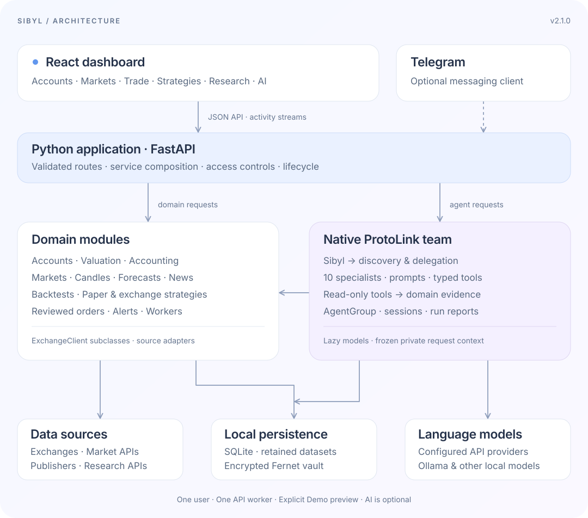

<p align="center">
  
</p>

# Sibyl · Your connected crypto workspace

**All your exchanges. Your research. An AI team that understands the context.**

Sibyl brings your crypto accounts, market analysis, trading and strategy research into one workspace you run on your own machine. Connect multiple exchanges, see your holdings together, explore a market, test an idea and follow it through to execution, having specialist AI agents beside you at every step.

The legacy Python/Streamlit application is available at [sibyl-streamlit](https://github.com/nMaroulis/sibyl-streamlit).

[](https://nmaroulis.github.io/sibyl/changelog)
[](https://www.python.org/)
[](https://react.dev/)
[](https://github.com/nMaroulis/protolink)
[](LICENSE)

[Documentation](https://nmaroulis.github.io/sibyl/) · [Getting started](docs/docs/getting-started/installation.md) · [Changelog](docs/docs/changelog.md) · [Implementation checklist](docs/docs/developers/backend-roadmap.md)

## One workspace, from understanding to action

- **See the whole picture.** Combine accounts across exchanges, or focus on one exchange, account or asset.
- **Research before you trade.** Inspect prices, statistics, news and historical strategy results in the same place.
- **Ask a specialist.** Open a contextual conversation on a page, or let Sibyl consult the team for you.
- **Keep control.** Credentials are encrypted locally. Exchange execution needs explicit setup and approval; AI tools are read-only.
- **Explore at your own pace.** Start without credentials, connect your accounts when ready, or use the clearly labeled Demo preview.

The interface pairs a floating navigation dock with focused workspaces, interactive charts and expandable advanced controls. React handles the experience; a modular Python backend owns the data, calculations and execution.

## Explore the modules

### Account · Know what you own

Bring multiple exchange accounts into a combined portfolio and switch between exchange and individual-account views. Inspect allocations, free and reserved balances, valuation history and conversion evidence, with filters and CSV exports.

Balance checks compare saved starting quantities with retained trades, fees and eligible funding. Missing prices and incomplete history stay visible. Production holdings, test funds and Demo are kept distinct.

[Account guide](docs/docs/guides/account.md) · [Balance checks](docs/docs/guides/balance-checks.md)

### Markets · Look beyond the price

Search available spot pairs, manage source-specific watchlists and choose public exchange feeds, saved exchange accounts or supported data APIs. Explore line and candlestick charts with indicators, OHLCV inspection, volume, region zoom, panning and exports.

Python calculates returns, trend and momentum, volatility, drawdowns, volume statistics and correlations. An explainable technical-bias score shows its inputs and votes. Retained candles, resumable historical imports and immutable datasets give your research a reusable foundation.

[Markets guide](docs/docs/guides/markets.md) · [Statistics and score](docs/docs/guides/market-statistics.md) · [History and datasets](docs/docs/guides/market-history.md)

### Trade · Follow an order through

Review spot market and GTC limit orders on supported exchanges, or practice with the persistent Demo wallet. Monitor orders, partial fills and cancellation evidence; recover uncertain submissions by client ID without blindly submitting again.

Account history brings together selected-market fills, native-currency fees, supported funding imports and retained FIFO performance. Review possible transfers between your accounts, inspect observed funding corrections and opt into bounded recent-history or pending-record updates.

Execution, imports and recovery vary by provider. Each exchange card in Settings shows the capabilities actually implemented for that provider and environment.

[Trading guide](docs/docs/guides/trading.md) · [Exchange support](docs/docs/developers/exchange-clients.md)

### Strategies · Test, compare, monitor

Build with six algorithms: **EMA Crossover, RSI Reversion, Bollinger Bands, Bollinger Surge, Impulse Breakout and Quantum Momentum**. Start with a simple configuration, then expand indicator, risk and execution settings.

- **Backtest:** model fees and slippage; inspect buys and sells on the price chart, equity against buy-and-hold, drawdowns and trade-level metrics.
- **Validate:** run bounded parameter searches, chronological holdouts and expanding walk-forward tests. Save inputs, compare compatible experiments and rerun exact datasets.
- **Monitor:** follow paper or separately approved exchange runs through charts, execution markers and a persistent decision journal.
- **Control:** use account-bound budgets, order limits, a global strategy halt and optional shared exposure and observed daily-loss controls.

[Strategy studio](docs/docs/guides/strategies.md) · [Validation](docs/docs/guides/strategy-validation.md) · [Exchange execution](docs/docs/guides/strategy-execution.md)

### Sibyl & Agents · A team you can talk to

Ask Sibyl a question in its dedicated chat. Powered by [ProtoLink](https://github.com/nMaroulis/protolink), Sibyl discovers the registered specialists, chooses whom to consult and brings their evidence into one answer. Saved conversations, live activity, consultation trails and run details make the work inspectable.

Each specialist has its own prompt, typed tools and page guidance. The **Ask** button opens a conversation in the page you are using. Choose an API model or local inference, with optional model overrides per agent.

| Agent | Focus |
| --- | --- |
| **Sibyl** | Coordinate the team and combine specialist findings |
| **Accountant** | Holdings, valuation, retained history and accounting evidence |
| **Analyst** | Markets, technical statistics and correlations |
| **Broker** | Trade, order evidence, backtests and strategy monitors |
| **Chronos** | Trained forecasts, held-out evaluation and baseline assumptions |
| **Reporter** | Source-linked news, article excerpts and text sentiment |
| **Technician** | Connections, settings, model setup and diagnostics |
| **Wiki** | Crypto concepts and project profiles |
| **Explorer** | Recent Bitcoin blocks and network context |
| **Equity Analyst** | Equity prices, company information and statistics |
| **Oracle** | Portfolio context and an overview of the workspace |

Sibyl requires a configured language model; module specialists also offer factual tool mode. Telegram lets an explicitly configured private user talk to Sibyl through a bot. WhatsApp, Discord, Slack, Signal and Email setup previews are marked unavailable.

[Sibyl guide](docs/docs/guides/sibyl.md) · [Model setup](docs/docs/guides/settings.md) · [Telegram](docs/docs/guides/telegram.md)

### News · Read with context

Follow CoinDesk, Cointelegraph, Decrypt, The Block and CryptoSlate through public collectors, with optional NewsAPI access. Search a retained, deduplicated archive; filter by publisher, asset, date and text polarity; open full reporting at its original source.

Tone and trend views describe the wording of headlines and excerpts. The separately attributed Alternative.me Fear & Greed index adds broader market context. Reporter can explain the selected stories and their sources.

[News and sentiment](docs/docs/guides/research.md#reporter-news-and-insights)

### Forecast · Train, evaluate, inspect

Fit lightweight daily autoregressive ridge models from your current feed or immutable datasets. Inspect chronological held-out results against naïve and drift benchmarks, empirical bands, exact-input reruns and numbered model versions. Forecast retained input offline or explicitly refresh the original matching feed, with provenance and input-shift diagnostics.

Chronos explains the same evidence through native ProtoLink tools. The separate **Statistical baseline** tab retains the untrained drift/volatility projection. Future accuracy and coverage remain uncertain; neural model families, rolling evaluation and automated recalibration are pending.

[Forecasting guide](docs/docs/guides/forecasting.md) · [Engine contracts](docs/docs/developers/forecasting.md)

### Research · Understand the wider picture

Browse 20 familiar crypto projects with backend-fetched fundamentals, history excerpts and source links. Look up concepts in the glossary, inspect recent Bitcoin blocks, or explore optional equity quotes, adjusted history and company information.

Wiki, Explorer and Equity Analyst help explain the same underlying evidence.

[Research guide](docs/docs/guides/research.md)

### Alerts · Keep useful signals close

Create price-level and crossing rules, follow strategy lifecycle events, watch recorded connection failures, and monitor selected accounts for value floors, concentration or observed drawdowns. A persistent local inbox retains the triggering evidence and unread state.

[Alerts guide](docs/docs/guides/alerts.md) · [Account risk](docs/docs/guides/account-risk.md)

### Settings & Coming soon · Make it yours

Manage **Exchanges, AI models, News, Market data, Messaging and Workspace** in one place. Exchange cards expose implementation coverage; source diagnostics distinguish observed connectivity from quote freshness. Ollama setup can detect the server and installed models, with explicit controls for a server started by Sibyl.

**More → Coming soon** lists available foundations and pending work. Multi-user hosting is deferred; the current deployment is one user and one API worker.

[Settings guide](docs/docs/guides/settings.md) · [Ollama](docs/docs/guides/ollama.md) · [Feature coverage](docs/docs/guides/feature-coverage.md)

## Exchange connections

Sibyl includes adapters for **20 production exchanges**, dedicated **Binance Spot Testnet** and **Coinbase Exchange Sandbox** clients, and an offline **DemoClient**:

Binance, Binance.US, Coinbase, Kraken, OKX, Bybit, KuCoin, Gate, Bitget, MEXC, HTX, Crypto.com Exchange, Bitstamp, Gemini, Bitfinex, CoinEx, BitMart, Phemex, Poloniex and Upbit.

Adapters share an `ExchangeClient` contract and explicit provider subclasses over CCXT. Available account, market-data, order and history methods depend on the provider. Implemented capability and authenticated acceptance are documented separately in the [support matrix](docs/docs/developers/exchange-clients.md) and [acceptance results](docs/docs/developers/exchange-acceptance.md).

## Architecture



The Python application owns the dashboard API and the optional Telegram worker. Domain modules own calculations and state; native ProtoLink agents call their read-only functions. Sibyl uses registry discovery and native delegation to consult specialists. Exchange writes go through the separate reviewed trading pipeline.

SQLite retains accounts, ledgers, research inputs, runs, conversations and alerts. A local Fernet vault encrypts credentials. Ordinary typed Python tools, lazy model factories, private request context and native run reports keep the AI layer close to ProtoLink's API.

| Directory | Responsibility |
| --- | --- |
| `frontend/src/` | React pages, charts, contextual chat and shared controls |
| `src/sibyl/api/` | FastAPI routes, validation and application lifecycle |
| `src/sibyl/exchanges/` | Shared client interface, provider adapters and Demo |
| `src/sibyl/accounting/` | Funding, transfers, balance checks and accounting rules |
| `src/sibyl/forecasting/` | Training, evaluation, JSON model registry and retained forecasts |
| `src/sibyl/strategies/` | Signals, backtests, validation, paper and exchange runs |
| `src/sibyl/market_data/`, `src/sibyl/news/` | Candle history, datasets and news collection |
| `src/sibyl/agents/` | Agent declarations, prompts, tools and native runtime integration |
| `src/sibyl/alerts/`, `src/sibyl/messaging/` | Alert rules, the local inbox and messaging clients |
| `src/sibyl/services/` | Domain coordination and focused funding-sync workers |
| `docs/` | Docusaurus user guides, API contracts and implementation checklist |

[Architecture guide](docs/docs/developers/architecture.md) · [Diagram source](docs/static/img/architecture.mmd) · [API reference](docs/docs/developers/api.md)

## Run Sibyl

You need **Python 3.12+**, [uv](https://docs.astral.sh/uv/) and **Node.js 22.12+**.

```bash
git clone https://github.com/nMaroulis/sibyl.git
cd sibyl
uv sync --frozen --group dev
npm ci
cp .env.example .env
```

Start the Python backend:

```bash
uv run sibyl
```

In another terminal, start the dashboard:

```bash
npm run dev
```

Open **http://127.0.0.1:5173**. A new workspace has no active accounts: connect one or several in Settings, or choose the smaller **Preview with Demo** option. Public market prices default to Binance; choose Demo prices for offline charts. News and other research sources have their own settings.

AI is optional for the data and trading workspaces. Configure a model in **Settings → AI models** to enable model-backed conversations and Sibyl. For SDK-based providers, install the corresponding optional extra, for example:

```bash
uv sync --frozen --group dev --extra openai
```

Ollama and supported OpenAI-compatible HTTP servers do not need a hosted-provider SDK. Follow the [installation guide](docs/docs/getting-started/installation.md) for other extras and local-model setup.

### Serve a built dashboard

```bash
npm run build
uv run sibyl
```

FastAPI serves the built dashboard at **http://127.0.0.1:8000**, alongside `/docs` for OpenAPI and `/health` for process health. A [Docker Compose setup](docs/docs/developers/deployment.md) is also included.

Credentials stay encrypted on the machine running the backend and are never returned to the UI or agent tools. Preserve the database and vault key together. Remote access requires a workspace API token; use the [deployment guide](docs/docs/developers/deployment.md) when hosting. Exchange and automated strategy execution are disabled by default and require separate server flags and reviewed approvals.

## Documentation & development

```bash
npm run docs:dev       # http://localhost:3000/sibyl/
npm run docs:build     # Static documentation in docs/build
uv run pytest
uv run ruff check src tests
npm run typecheck
npm run build
```

Start with the [user guides](https://nmaroulis.github.io/sibyl/), explore the [Python architecture](docs/docs/developers/architecture.md), or use the [extension guide](docs/docs/developers/extending.md) to add a client, strategy or agent tool. The [pending checklist](docs/docs/developers/backend-roadmap.md) tracks work beyond the v2.0.0 baseline.

Sibyl is released under the [Apache License 2.0](LICENSE).
